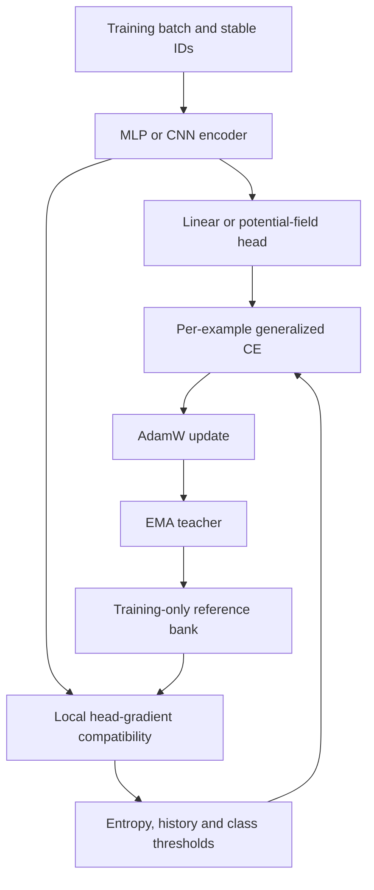
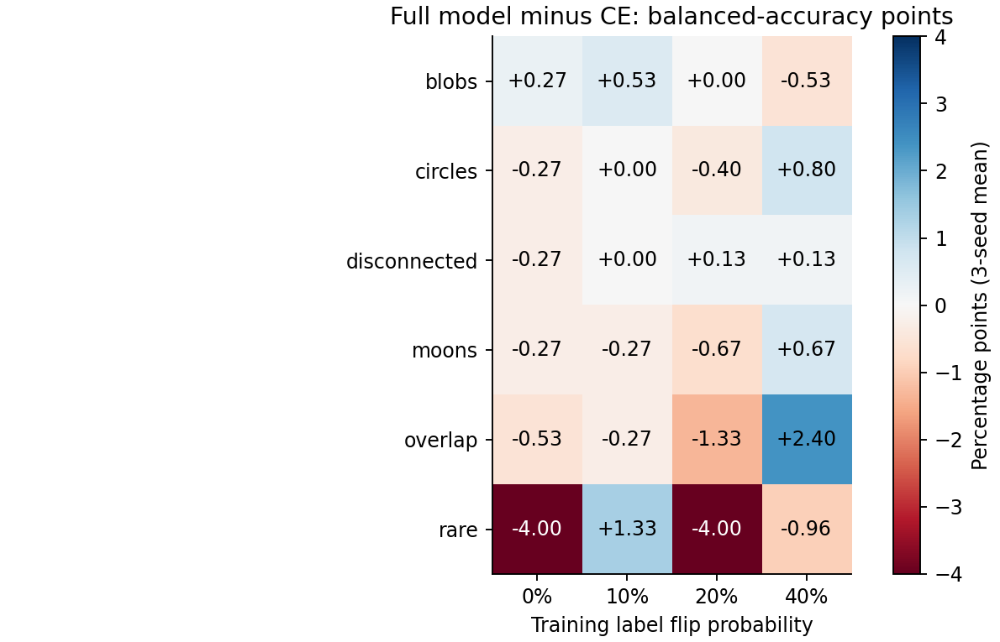
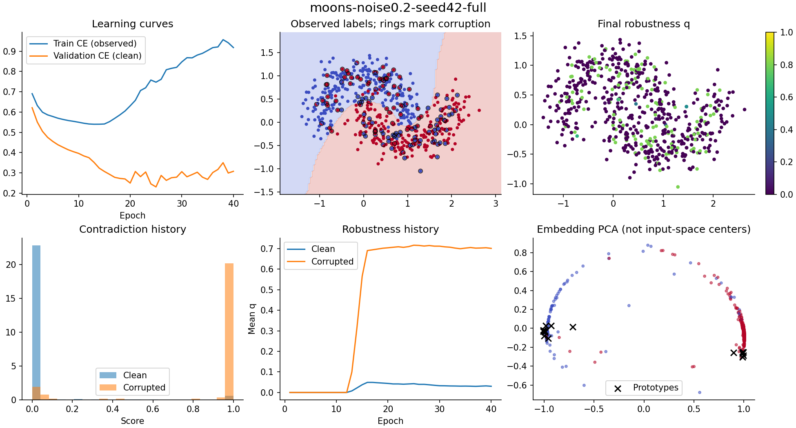

# LossLearning

**Local Gradient-Influence Guided Adaptive Robust Learning**

A PyTorch classification framework that adapts generalized cross-entropy using
local head-gradient compatibility, teacher prediction history and class-aware
reliability thresholds. It asks whether a difficult example provides useful
supervision or conflicts with a stable training neighborhood.

**Status: experimental v0.1.0. The performance hypothesis is not established.**
The code is tested and the results are reproducible, but the full model does not
consistently beat cross-entropy. Across 72 paired synthetic settings it wins 25,
ties 17 and loses 30, averaging **0.31 percentage points lower balanced accuracy**.
This repository preserves the failures as well as the gains.

## Why investigate this?

A large training loss can come from a useful boundary example or an incorrect
label. LossLearning combines additional local evidence before reducing that
example's gradient. It uses training data only; no hidden clean reference labels.
The controller is a deterministic rule, not a trained meta-network.

The proposed contribution is the specific controller and its evaluation, not a
new GCE loss family or a demonstrated novel learning principle. Instance-adaptive
robust losses, gradient influence and class-aware weighting have substantial prior
art. See the [literature review](docs/literature_review.md).

## Architecture



Default: ordinary linear head. Set `head="potential"` for the full configuration.
The potential head adds trainable inverse-multiquadric features:

$$\phi_m(h)=\left(1+\frac{\|h-\mu_m\|^2}{s_m^2}\right)^{-p_m}.$$

The final linear head's CE gradients factor exactly as
$\langle g_i,g_j\rangle=(r_i^Tr_j)(\psi_i^T\psi_j)$, where $r=P-e_y$.
Negative alignment, low neighbor-label entropy and support for another class
increase contradiction. A smoothed, class-aware threshold maps that evidence to q:

$$L_q(p_y)=\begin{cases}-\log p_y&q=0\\(1-p_y^q)/q&q>0.\end{cases}$$

The gradient is $p_y^q(P-e_y)$ for fixed q. **This is equivalent to detached
weighted-CE gradients for the current step.** The controller's evidence, rather
than a fundamentally new first-order update, is the research question.
Full [derivations, assumptions and counterexamples](docs/mathematics.md) are included.

## Install

Python 3.10+:

```bash
python -m venv .venv
# Activate the environment using your platform's command.
pip install torch --index-url https://download.pytorch.org/whl/cpu
pip install -e ".[dev]"
pytest -q
```

For CUDA, install a compatible PyTorch build for your driver. Image loaders are
optional: `pip install -e ".[images]"`. The core smoke run needs only CPU.

## Quick start

```python
from sklearn.datasets import make_moons
from sklearn.model_selection import train_test_split
from losslearning import LossLearning

X, y = make_moons(n_samples=2000, noise=0.2, random_state=42)
X_train, X_test, y_train, y_test = train_test_split(
    X, y, test_size=0.2, stratify=y, random_state=42
)
model = LossLearning(encoder="mlp", adaptive_loss=True, random_state=42)
model.fit(X_train, y_train)
print("Accuracy:", model.score(X_test, y_test))

probabilities = model.predict_proba(X_test)
model.save("checkpoints/losslearning.pt")
restored = LossLearning.load("checkpoints/losslearning.pt")
```

The executed example scored **0.96**. See [examples/quickstart.py](examples/quickstart.py).
Only load trusted checkpoint files. `get_params`, `set_params`, string labels,
`classes_`, `history_`, `q_` and `contradiction_scores_` are supported.
For larger datasets use the indexed DataLoader trainer described in
[architecture.md](docs/architecture.md).

## Reproduce experiments

```bash
losslearning-train --config configs/quick.yaml
losslearning-influence --output results/influence
losslearning-benchmark --config configs/synthetic.yaml
losslearning-ablate --config configs/ablation.yaml
losslearning-benchmark --config configs/class_dependent.yaml
losslearning-figures --results results/runs/YOUR_RUN_DIRECTORY
```

Supported synthetic geometries: moons, circles, three-class blobs, overlapping
classes, disconnected clusters and a rare-class cluster mixture. Noise can be
symmetric or class dependent and affects training only. Standard configurations
include 0%, 10%, 20% and 40% symmetric flips. Image configurations support Fashion-
MNIST and CIFAR-10. See [reproducibility.md](docs/reproducibility.md) for budgets.

## What actually ran

| Experiment | Completed budget |
|---|---|
| Symmetric-noise synthetic | 504 fits: 6 geometries × 4 noise levels × 3 seeds × 7 methods |
| Ablations | 84 fits: 2 geometries × 3 seeds × 14 variants |
| Class-dependent corruption | 36 fits: 2 geometries × 2 noise levels × 3 seeds × 3 methods |
| Quick noisy-moons demonstration | 2 fits, CE versus full model |
| Fashion-MNIST pilot | 4 fits; 2,000 train / 1,000 validation / 1,000 test, 10 epochs, seed 42 |
| Numerical checks | Autograd, finite differences, 576 head-step pairs per learning rate, stale-feature comparisons |
| Tests | 25 passing unit/integration tests; Ruff checks pass |

CIFAR-10 training and full-scale image benchmarks **were not run**. Its download
was interrupted while incomplete; no score is implied by the supplied configuration.
GitHub Actions is configured but has not been run on GitHub. No CI badge is claimed.

## Results

The single quick run at seed 42 and 20% label noise scored **94.4% CE versus
97.6% full model**. That improvement does not generalize consistently across seeds.
Below are three-seed mean balanced accuracies at 20% symmetric noise:

| Dataset | CE | Fixed GCE | Adaptive, linear head | Full model |
|---|---:|---:|---:|---:|
| Moons | 96.40% | 94.13% | 95.47% | 95.73% |
| Circles | 99.20% | 99.07% | 98.27% | 98.80% |
| Three-class blobs | 98.27% | 98.00% | 98.27% | 98.27% |
| Overlap | 92.80% | 91.20% | 91.20% | 91.47% |
| Disconnected | 99.20% | 99.47% | 99.47% | 99.33% |
| Rare class | 95.26% | 87.26% | 95.93% | 91.26% |



The full model's observed median wall time was about **2.34× CE**, on a shared CPU
host. This is descriptive, not a dedicated-hardware speed benchmark. CE uses
2,338 parameters and full uses 2,914 for binary 2D tasks. A wider 2,898-parameter
MLP CE baseline is included, along with potential-head CE to separate architecture
from loss. Focal and fixed-GCE baselines use the same ordinary architecture.

Fashion-MNIST pilot: CE **76.7%**, fixed GCE **76.6%**, adaptive linear **76.7%**,
full **77.3%**. Adaptive runs ended at q=0 and complete fallback, so this pilot
**does not demonstrate useful image loss adaptation**. Small single-seed accuracy
differences must not be attributed to the adaptive mechanism.

All seed-level metrics, configurations, histories, split IDs and saved predictions
are in [results/release](results/release). [Result tables](docs/result_tables.md)
include standard deviations. [Experiment interpretation](docs/experiments.md)
explains outcomes and limitations. No published strong-baseline scores are
presented as if reproduced under this protocol.

## Ablation findings

At 20% noise, removing gradient alignment slightly improved moons and slightly
hurt the rare task. Removing history or stability filtering did not improve
moons; entropy made little difference in these runs. Count-based class protection
helped slightly relative to removing it, but did not prevent minority harm.
The quantile-threshold variant improved rare-task balanced accuracy to **99.26%**,
versus **91.26%** for default full and **96.59%** for same-head CE. This is an
exploratory result among many ablations, not a held-out validation of a new default.
The original default remains unchanged. Neighbor count and cached features have
condition-dependent effects; no component is established as universally beneficial.



## Known limitations and appropriate use

Use this repository to study robust learning, test controllers, and reproduce
experiments. Do not treat it as a generally superior classifier or an automatic
label-cleaning oracle. Clean/rare examples can be suppressed; a wrong teacher can
reinforce its own mistakes. At high corruption, reference coverage may disappear
and adaptation falls back to CE. In binary classification the residual cosine
largely reduces to label agreement, weakening a unique influence interpretation.
The estimate concerns head-only SGD, while training uses full-network AdamW.

CUDA, full-data image training, AMP, gradient accumulation, suppression budgets,
strong baselines such as DivideMix/ELR/ProMeCD, and full sklearn compliance remain
unverified or unimplemented. See [limitations.md](docs/limitations.md).

## Repository organization

`src/losslearning/` contains models, losses, adaptation, trainer, estimator,
image/data adapters and experiment commands. `tests/` checks numerical and system
behavior. `configs/` fixes reproducible budgets. `docs/` contains math, literature,
API and experiment reports. `assets/` and `results/release/` contain measured figures
and auditable results. `experiments/release_report.py` rebuilds the release audit.

## Related work, citation and license

The design builds on GCE, instance-adaptive robust training, Ren et al.'s example
reweighting, TracIn, teacher/history methods, and class-aware weighting. Close 2026
work is explicitly discussed in the [literature review](docs/literature_review.md).
Novelty and state-of-the-art performance are not claimed.

MIT license. Cite this software version using [CITATION.cff](CITATION.cff), alongside
relevant original methods. This is software, not a published research paper.
See [CONTRIBUTING.md](CONTRIBUTING.md) for checks and experimental standards.

To publish manually, create an empty GitHub repository, review the included files,
then add your remote and push your local commit. Datasets and checkpoints are
ignored. No remote repository or publication was created by this build.
